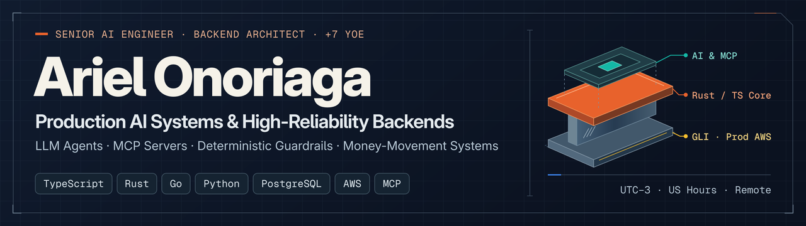

  

 

[Featured: Iron Suite](#-featured--iron-suite) · [AI & Rust Open Source](#-ai--rust-open-source) · [Production Systems](#-production-systems) · [Regulated AWS](#-regulated-cloud-systems-aws) · [Writing](#-architecture-write-ups)

---

## Featured — Iron Suite

  

> Most AI coding loops fail in production because memory is noisy and review is rubber-stamped. **[Iron Suite](https://github.com/arielonoriaga/iron-suite)** pairs a zero-cloud **SQLite FTS5 + stdio MCP memory hub** in Rust (with hard UTF-8 byte budgets, cross-session anchor linking, and SSH multi-machine sharing) with **7 role-isolated engineering skills & adversarial review subagents** for Claude Code, Codex, Cursor, and Antigravity.

---

## AI & Rust Open Source

| Repository | What it solves | Stack |
|:---|:---|:---|
| **[iron-suite](https://github.com/arielonoriaga/iron-suite)** | Zero-cloud SQLite FTS5 + stdio **MCP memory hub** and 7 adversarial multi-agent engineering skills (`irondev`, `irondev-review`, `iron-hunt`, `iron-debug`, `iron-perf`, `iron-audit`). | `Rust` `MCP` `SQLite FTS5` |
| **[claude-harness](https://github.com/arielonoriaga/claude-harness)** | Safety & self-improvement harness for AI coding agents — deterministic Rust `PreToolUse` guardrail, cross-session journal bus, detached test agent, and review queue. | `Rust` `Shell` |
| **[claude-irondev](https://github.com/arielonoriaga/claude-irondev)** | Adversarial multi-lens code-review subagent and orchestrated dev cycle for Claude Code. Refuses to rubber-stamp. | `Claude Code` `Agents` |
| **[entropy-hunter](https://github.com/arielonoriaga/entropy-hunter)** | Deterministic code-health analyzer (complexity, coupling, churn, duplication) built as a CI regression gate to prevent AI-generated codebase drift. | `TypeScript` `Rust` `Bun` |
| **[lazyfetch](https://github.com/arielonoriaga/lazyfetch)** | Terminal HTTP client published on [crates.io](https://crates.io/crates/lazyfetch) as a 7-crate hexagonal Rust workspace with an IO-free core enforced in CI (146 tests). | `Rust` `Tokio` `ratatui` |
| **[claude-statusline-bar](https://github.com/arielonoriaga/claude-statusline-bar)** | Information-dense terminal status line for Claude Code — context usage, rate-limit countdowns, color ramps, and git state. | `Shell` |

---

## Production Systems

### Ez-Commerce & Huggian Platform — Multi-Tenant SaaS + In-App AI Assistant

Built and operated solo with AI-augmented workflows inside strict architecture, review, and test gates — running autonomously on rollback-safe Linux infrastructure (**[arielonoriaga.huggian.com](https://arielonoriaga.huggian.com)** · **[huggian.com](https://huggian.com)**).

<table>
<tr>
<td valign="top" width="50%">

**Production AI & Agentic Workflows**
- In-app **AI assistant** inside Ez-Commerce for retail operations
- **Multi-model LLM pipelines** (Anthropic, OpenAI, Google, Groq) with deterministic tool boundaries, cost caps, and human-in-the-loop checkpoints
- Consolidated three live services plus a new **AI module** into one Rust API & worker with scoped API keys, monthly quotas, and zero-reissue dual-hash migration

</td>
<td valign="top" width="50%">

**Backend, Payments & Reliability**
- Cut incremental Rust build times by **5.0×–8.7×** (`48s → 5.5s`) by splitting a 543k-LOC crate into a **30-crate Cargo workspace** (44 bounded contexts, 481 migrations, **915 releases**, **62,647 sales** across 14 shops)
- Retry-safe money movement: **idempotency keys**, guarded SQL state transitions, offline POS sync, and a **transactional outbox** (`SKIP LOCKED` leased claims)
- Shared **TypeScript billing, entitlement, and identity core** (Bun, Hono, Drizzle, PostgreSQL; 27 bounded contexts)

</td>
</tr>
</table>

---

## Regulated Cloud Systems (AWS)

Core backend & platform engineer since Dec 2021 on a multi-tenant **real-money gaming platform on AWS** (Go & TypeScript serverless monorepo deployed to isolated per-tenant environments).

- Architected and maintain **5 shared TypeScript libraries** and a standardized game template adopted across all studio game teams.
- Co-developed RNG and game-math services with Monte Carlo simulation tooling (**Go, Rust, Python**) for regulated products that passed **GLI (Gaming Laboratories International)** certification.
- Own **Terraform IaC** and GitHub Actions CI/CD across Lambda, API Gateway, DynamoDB, Aurora, ECS, CloudFront, SQS/SNS, and IoT Core, plus internal Rust/Go deploy tooling.

Earlier: promoted from trainee to **Engineering Lead of 7 engineers** in under two years at PicallEx (introducing TypeScript and Vitest across Vue/PHP/SQL teams).

---

## Architecture Write-Ups

- **[Payments that survive retries: idempotency keys, guarded transitions and an outbox in Rust](https://arielonoriaga.huggian.com/writing/payments-that-survive-retries/)**
- **[Three services, one Rust binary: a phased live migration](https://arielonoriaga.huggian.com/writing/three-services-one-rust-binary/)**

---

<b>Technical Stack — click to expand</b>

 

| Layer | Technologies |
|:---|:---|
| **AI & Agentic Systems** | LLM orchestration (Anthropic, OpenAI, Google, Groq) · Model Context Protocol (MCP) · deterministic tool-call guardrails · multi-agent workflows · SQLite FTS5 retrieval · human-in-the-loop · CI quality/eval gates |
| **Languages** | TypeScript · Rust · Go · Python · SQL |
| **Backend & Data** | Axum · Tokio · SQLx · Node / Bun · Hono · Drizzle · PostgreSQL · DynamoDB · Redis · transactional outbox · idempotency keys · queues (SQS/SNS) · MQTT |
| **Cloud & Ops** | AWS (Lambda, API Gateway, DynamoDB, Aurora, ECS, CloudFront, IoT Core, SQS/SNS) · Terraform · Docker · GitHub Actions · nginx · systemd |
| **Frontend & Practices** | SolidJS · React · Vue · Astro · PWA / offline sync · DDD / Hexagonal · property & mutation testing · rollback-safe deploys |

---

Open to **full-time remote (US/global)** and **senior contract** roles in **AI Engineering, Agentic Systems, and Production Backends**.

📍 Argentina · 🕒 UTC−3 (full US business-hours overlap) · ✉️ [onoriagaariel@gmail.com](mailto:onoriagaariel@gmail.com) · 🌐 [arielonoriaga.huggian.com](https://arielonoriaga.huggian.com)

